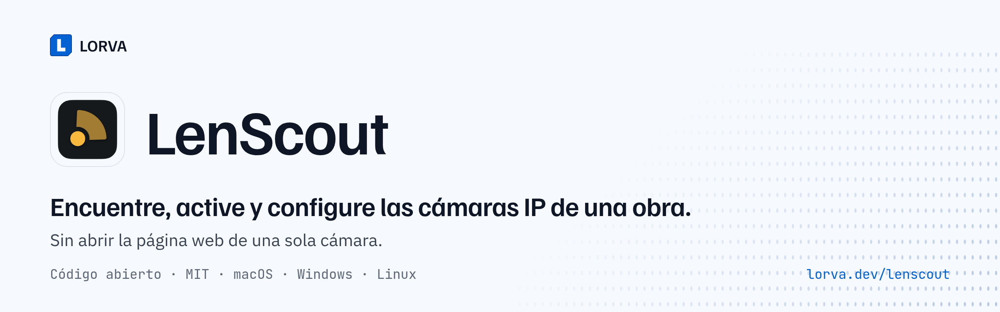

<p align="center"><a href="README.md">English</a> · <a href="README.fr.md">Français</a> · <b>Español</b></p>

<picture>
  <source media="(prefers-color-scheme: dark)" srcset="docs/assets/banner-es-dark.png">
  
</picture>

# LenScout

[](https://github.com/Ops-Lorva/lenscout/releases/latest)
[](LICENSE)

Encuentre, active y configure las cámaras IP de una obra, sin abrir la página web de una sola cámara.
Una sola aplicación de escritorio para macOS, Windows y Linux. Página del producto: [lorva.dev/lenscout](https://lorva.dev/lenscout/).

<!-- screenshot: Network tab showing discovered cameras (brand, model, IP, MAC, state). Place image at docs/assets/lenscout-network.png -->

## El problema

Poner en marcha un parque de cámaras obliga a repetir las mismas tareas en cada equipo:
encontrarlo en la red, activarlo, fijar su IP y su puerta de enlace, ajustar su hora, crear
su cuenta. Las herramientas de los fabricantes están separadas por marca y a menudo solo
funcionan en Windows: AXIS IP Utility solo existe para Windows, y cada fabricante tiene la
suya. Se acaba entrando en la página web de una cámara tras otra, repitiendo los mismos
pasos a mano. Es lento, propenso a errores y no escala más allá de unas pocas cámaras.

## Qué hace LenScout

LenScout es una aplicación de escritorio para instaladores e integradores. Descubre las
cámaras IP de una red, activa las nuevas, fija su IP / máscara / puerta de enlace / DNS, su
NTP y su zona horaria, y sus credenciales, y luego muestra su vídeo en directo para
orientarlas y enfocarlas durante la instalación. Todo desde una sola ventana, en macOS,
Windows y Linux.

Cuando todo un parque necesita el mismo cambio (un nuevo plan de direccionamiento, otro
servidor NTP, una rotación de contraseñas), la pestaña **Operaciones** lo aplica a todas
las cámaras marcadas de una sola vez, tras una vista previa antes / después, en lugar de
una página web por cámara.

Es una herramienta de **instalación**: sin supervisión continua, sin grabación.

La interfaz tiene cuatro pestañas (**Red**, **Encuadre**, **Cuentas**, **Operaciones**),
en francés, inglés y español.

## Funciones

### Descubrimiento
- Escanea la red y lista las cámaras con marca, modelo, IP, MAC, número de serie, versión
  de firmware (cuando se puede leer) y estado (nueva / activada).
- Axis por mDNS (`_axis-video._tcp`), WS-Discovery y un escaneo enrutado; ONVIF como
  respaldo; prefijo MAC (OUI) para nombrar un equipo que no responde a ningún protocolo.
- **Reescanear** cuando se quiera; la lista se rellena a medida que avanza el escaneo.
- Búsqueda por MAC o número de serie: escriba lo que figura en la caja, en cualquier
  formato de MAC habitual (`AC:CC:8E:…`, `ACCC8E…`, `ac-cc-8e-…`), y la lista se reduce a
  esa cámara, incluso en una red de varios cientos de equipos.
- Un botón **Abrir la página web** abre `http(s)://IP` en el navegador predeterminado.

### Configuración de red
- Active una cámara nueva fijando la contraseña de la cuenta elegida.
- Cambie entre DHCP e IP fija, con máscara, puerta de enlace y DNS.
- Asigne un rango en lote (`10.0.50.11`, `.12`, `.13`…) con una vista previa por cámara
  (MAC y número de serie frente a la IP que recibirá cada una) que se confirma antes de
  aplicar nada. Una acción en lote nunca toca una cámara que no haya seleccionado.
- Una cámara nueva suele estar fuera de la subred del equipo. Para Axis, LenScout añade
  temporalmente a su interfaz de red una IP de la subred correcta (pidiendo permisos de
  administrador), configura la cámara y vuelve a quitar esa IP, también después de un
  error.

### Operaciones
- Aplique un mismo cambio a todas las cámaras marcadas a la vez: **Mantener las IP**
  (nueva máscara, puerta de enlace o DNS, direcciones intactas), **Renumerar** desde una
  dirección de inicio, **Poner la hora** (NTP y zona horaria) o **Cambiar las
  credenciales** (Axis).
- Una vista previa antes / después lista cada cámara con lo que va a cambiar y señala las
  filas que fallarían: dirección ya ocupada, dirección de red o de difusión, puerta de
  enlace fuera de la subred, cámara en DHCP, fuera de la red de la cuenta. No se aplica
  nada mientras una fila bloquee.
- Se aplica tras una confirmación explícita, cámara por cámara, con un botón **Detener**
  que para después de la cámara en curso, y luego un informe: correctas, fallidas,
  inalcanzables en la nueva dirección.
- Cambiar las credenciales fija el usuario de la cuenta seleccionada. Las contraseñas
  actuales que hay que probar se escriben solo para esa ejecución, nunca se guardan ni se
  registran, y la ejecución se detiene en una cámara cuando seguir podría bloquear su
  cuenta.
- **Prueba de acceso**: prueba la cuenta elegida en cada cámara marcada, en solo lectura
  (Axis y Hikvision / LTS), y lista OK, rechazado, inalcanzable u otro equipo; una cámara
  rechazada dos veces en 30 min no se vuelve a probar. Exportación CSV.

### Cuentas
- Guarde cuentas con nombre (por ejemplo «LORVA por defecto» o «Cliente X»), cada una con
  usuario y contraseña, y elija la cuenta en cada acción que requiera autenticación: un
  cliente puede tener sus propias credenciales.
- **Relevar** la red de la cuenta en el sitio (ping, ARP, nombres NetBIOS y mDNS): cada
  equipo se guarda con su tipo, fabricante y nombre, cuenta como ocupado hasta
  «Olvidar», y por encima del 80 % de uso LenScout propone una máscara más amplia.
  Exportación CSV.

### Encuadre
- Conéctese a una cámara con la cuenta elegida y vea su vídeo en directo, lo bastante
  fluido para orientar y enfocar la cámara durante la instalación. Vistas multisensor,
  zoom y enfoque.

### Hora
- Fije el servidor NTP y la zona horaria en una o varias cámaras seleccionadas.

### Seguridad de las actualizaciones y de las credenciales
- Las contraseñas se sellan (XChaCha20-Poly1305) dentro del archivo de cuentas de la
  aplicación, de modo que el archivo no se puede leer ni buscar en claro, y nunca se
  escriben en un registro. La clave de sellado viene con el código abierto: impide leer el
  archivo de un vistazo, no es una caja fuerte. Proteja el archivo de cuentas y sus
  exportaciones como las contraseñas que contienen.
- LenScout busca una versión más reciente al arrancar. Cada instalador va acompañado de
  una firma minisign `.sig`, que la aplicación verifica antes de ejecutar nada de lo que
  ha descargado; una descarga que no supera la verificación no se ejecuta.

## Cámaras compatibles

- **Axis: compatibilidad completa**: descubrimiento, activación, configuración IP
  (DHCP / fija), credenciales, hora / NTP y encuadre.
- **Hikvision / LTS**: reconocidas en un escaneo enrutado (descubrimiento SADP e
  identificación ISAPI), distinguiendo LTS de Hikvision. La activación y el cambio de IP
  por SADP **aún no están habilitados**: no existe una fuente pública fiable sobre la
  codificación de la contraseña SADP, así que quedan desactivados hasta poder validarlos
  con equipos LTS reales.
- **Otras marcas** (encontradas solo por ONVIF o prefijo MAC): aparecen en la lista, con
  el botón **Abrir la página web**, pero sin configuración desde la aplicación.

## Para quién

- **Instaladores** que ponen en marcha parques de cámaras en obra y quieren una sola
  herramienta multiplataforma en lugar de un mosaico por marca y solo para Windows.
- **Integradores** que unifican la configuración de IP, hora y cuentas en muchas cámaras.
- **Técnicos de campo** que necesitan encontrar, alcanzar y encuadrar una cámara en una
  red desconocida sin rebuscar en interfaces web.

## Instalación

Descargue el instalador para su sistema desde la
[última versión](https://github.com/Ops-Lorva/lenscout/releases/latest):

| Sistema | Archivo |
|---|---|
| macOS (Apple Silicon e Intel) | `lenscout_vX.Y.Z_universal.pkg` (o `.dmg`) |
| Windows 10 / 11 | `lenscout_vX.Y.Z_x64-setup.exe` |
| Debian / Ubuntu | `lenscout_vX.Y.Z_amd64.deb` (`sudo apt install ./lenscout_vX.Y.Z_amd64.deb`) |

El instalador de Windows no está firmado, así que SmartScreen puede avisar en la primera
ejecución (Más información, Ejecutar de todas formas).

LenScout busca una versión más reciente al arrancar y propone instalarla. Cada instalador
va acompañado de una firma minisign `.sig`, que la aplicación verifica antes de ejecutar
nada de lo que ha descargado.

## Desarrollo

```bash
npm install
npx tauri dev
```

```bash
cargo test -p lenscout-core
cargo clippy --workspace -- -D warnings
npm test
```

## Estructura

- `crates/lenscout-core`: toda la lógica, sin Tauri, probada sin cámara.
- `src-tauri`: comandos Tauri finos.
- `src`: interfaz SvelteKit (fr, en, es).

## Licencia

MIT: consulte [LICENSE](LICENSE).

---

<p align="center"><sub>LenScout está hecho por <a href="https://lorva.dev">LORVA</a>, un estudio de software independiente.</sub></p>
