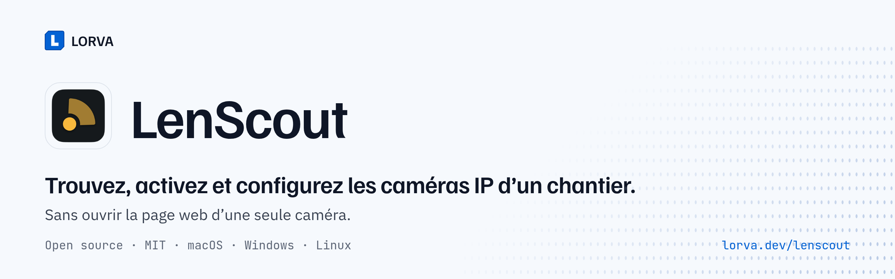

<p align="center"><a href="README.md">English</a> · <b>Français</b></p>

<picture>
  <source media="(prefers-color-scheme: dark)" srcset="docs/assets/banner-fr-dark.png">
  
</picture>

# LenScout

[](https://github.com/Ops-Lorva/lenscout/releases/latest)
[](LICENSE)

Trouvez, activez et configurez les caméras IP d’un chantier — sans ouvrir la page web d’une seule caméra.
Une seule application de bureau, sur macOS, Windows et Linux. Page produit : [lorva.dev/lenscout](https://lorva.dev/lenscout/).

<!-- capture : onglet Réseau avec les caméras découvertes (marque, modèle, IP, MAC, état). Image à placer dans docs/assets/lenscout-network.png -->

## Le problème

Mettre en service un parc de caméras, c’est refaire les mêmes gestes sur chaque appareil :
le trouver sur le réseau, l’activer, régler son IP et sa passerelle, corriger son heure,
créer son compte. Les outils des fabricants sont éclatés par marque et souvent réservés à
Windows — AXIS IP Utility ne tourne que sous Windows, et chaque constructeur livre le sien.
On finit donc par se connecter à la page web d’une caméra après l’autre, en répétant les
mêmes étapes à la main. C’est lent, source d’erreurs, et cela passe mal au-delà de
quelques caméras.

## Ce que fait LenScout

LenScout est une application de bureau pour les installateurs et les intégrateurs. Elle
découvre les caméras IP d’un réseau, active les neuves, règle leur IP / masque /
passerelle / DNS, leur NTP et leur fuseau horaire, et leurs identifiants, puis affiche leur
flux en direct pour les orienter et faire la mise au point pendant la pose — le tout depuis
une seule fenêtre, sur macOS, Windows et Linux.

Quand tout un parc doit recevoir le même changement — un nouveau plan d’adressage, un
autre serveur NTP, une rotation de mots de passe — l’onglet **Opérations** l’applique à
toutes les caméras cochées en une seule passe, après un aperçu avant / après, au lieu
d’une page web par caméra.

C’est un outil d’**installation** : pas de surveillance continue, pas d’enregistrement.

L’interface tient en quatre onglets — **Réseau**, **Cadrage**, **Comptes**, **Opérations** —
en français, en anglais et en espagnol.

## Fonctionnalités

### Découverte
- Scanne le réseau et liste les caméras avec leur marque, modèle, IP, MAC, numéro de série,
  version de firmware (quand elle est lisible) et état (neuve / activée).
- Axis par mDNS (`_axis-video._tcp`), WS-Discovery et un balayage routé ; ONVIF en
  repli ; préfixe MAC (OUI) pour nommer un appareil qui ne répond à aucun protocole.
- Nouveau scan à la demande ; la liste se remplit pendant le scan.
- Recherche par MAC ou numéro de série — tapez ce qui est imprimé sur la boîte, dans
  n’importe quel format de MAC courant (`AC:CC:8E:…`, `ACCC8E…`, `ac-cc-8e-…`), et la liste
  se réduit à cette caméra, même sur un réseau de plusieurs centaines d’appareils.
- Un bouton **Ouvrir la page web** ouvre `http(s)://IP` dans votre navigateur par défaut.

### Configuration réseau
- Activer une caméra neuve en lui posant le mot de passe du compte choisi.
- Passer du DHCP à une IP fixe, avec masque, passerelle et DNS.
- Attribuer une plage en lot (`10.0.50.11`, `.12`, `.13`…) avec un aperçu caméra par
  caméra — MAC et numéro de série en regard de l’IP que chacune recevra — à valider avant
  que quoi que ce soit ne soit appliqué. Une action en lot ne touche jamais une caméra que
  vous n’avez pas sélectionnée.
- Une caméra neuve se trouve souvent hors du sous-réseau du poste. Pour Axis, LenScout
  ajoute temporairement à votre interface réseau une IP du bon sous-réseau (en demandant
  les droits administrateur), configure la caméra, puis retire cette IP — y compris après
  une erreur.

### Opérations
- Appliquer un même changement à toutes les caméras cochées : **garder les IP** (nouveau
  masque, passerelle ou DNS, adresses inchangées), **renuméroter** à partir d’une
  adresse de départ, **régler l’heure** (NTP et fuseau horaire) ou **changer les
  identifiants** (Axis).
- Un aperçu avant / après liste chaque caméra avec ce qui va changer, et signale les
  lignes qui poseraient problème : adresse déjà prise, adresse de réseau ou de diffusion,
  passerelle hors du sous-réseau, caméra en DHCP, hors du réseau du compte. Rien n’est
  appliqué tant qu’une ligne bloque.
- Application après une confirmation explicite, caméra par caméra, avec un bouton
  **Arrêter** qui s’arrête après la caméra en cours, puis un rapport : réussies, en échec,
  injoignables à la nouvelle adresse.
- Changer les identifiants pose l’identifiant du compte choisi. Les mots de passe actuels
  à essayer sont saisis pour cette fois seulement, jamais enregistrés ni journalisés, et
  l’opération s’arrête sur une caméra dès que continuer risquerait de bloquer son compte.

### Comptes
- Enregistrez des comptes nommés (par exemple « LORVA défaut » ou « Client X »), chacun
  avec un identifiant et un mot de passe, et choisissez le compte à chaque action qui
  demande une authentification — un client peut avoir ses propres identifiants.

### Cadrage
- Se connecter à une caméra avec le compte choisi et afficher son flux en direct, assez
  fluide pour orienter la caméra et faire la mise au point pendant la pose. Vues
  multicapteur, zoom et mise au point.

### Heure
- Régler le serveur NTP et le fuseau horaire sur une ou plusieurs caméras sélectionnées.

### Sécurité des mises à jour et des identifiants
- Les mots de passe sont scellés (XChaCha20-Poly1305) dans le fichier des comptes de
  l’application : le fichier ne peut pas être lu ni fouillé avec `grep` en clair, et ils
  ne sont jamais écrits dans un journal. La clé de scellement est livrée avec le code
  open source : elle empêche de lire le fichier d’un coup d’œil, ce n’est pas un coffre-fort.
  Protégez le fichier des comptes et ses exports comme les mots de passe qu’ils
  contiennent.
- LenScout vérifie au démarrage s’il existe une version plus récente. Chaque installateur
  est livré avec une signature minisign `.sig`, que l’application vérifie avant d’exécuter
  quoi que ce soit qu’elle a téléchargé ; un téléchargement dont la vérification échoue
  n’est pas exécuté.

## Caméras prises en charge

- **Axis — prise en charge complète** : découverte, activation, configuration IP
  (DHCP / fixe), identifiants, heure / NTP et cadrage.
- **Hikvision / LTS** : reconnues au balayage routé (découverte SADP et identification
  ISAPI), LTS distinguée de Hikvision. L’activation et le changement d’IP par SADP ne sont
  **pas encore activés** — il n’existe pas de source publique fiable pour l’encodage du mot
  de passe SADP, ils restent donc coupés jusqu’à pouvoir être validés sur du vrai matériel
  LTS.
- **Autres marques** (trouvées seulement par ONVIF ou par préfixe MAC) : listées, avec le
  bouton **Ouvrir la page web**, mais sans configuration dans l’application.

## Pour qui

- Les **installateurs** qui mettent en service des parcs de caméras sur site et veulent un
  seul outil multiplateforme plutôt qu’un patchwork par marque, réservé à Windows.
- Les **intégrateurs** qui uniformisent la configuration IP, l’heure et les comptes sur de
  nombreuses caméras.
- L’**informatique de terrain**, qui doit trouver, joindre et cadrer une caméra sur un réseau
  inconnu sans fouiller les interfaces web.

## Installation

Téléchargez l’installateur de votre système depuis la
[dernière version](https://github.com/Ops-Lorva/lenscout/releases/latest) :

| Système | Fichier |
|---|---|
| macOS (Apple Silicon et Intel) | `lenscout_vX.Y.Z_universal.pkg` (ou `.dmg`) |
| Windows 10 / 11 | `lenscout_vX.Y.Z_x64-setup.exe` |
| Debian / Ubuntu | `lenscout_vX.Y.Z_amd64.deb` (`sudo apt install ./lenscout_vX.Y.Z_amd64.deb`) |

L’installateur Windows n’est pas signé : SmartScreen peut afficher un avertissement au premier lancement (Informations complémentaires, Exécuter quand même).

LenScout vérifie au démarrage s’il existe une version plus récente et propose de
l’installer. Chaque installateur est livré avec une signature minisign `.sig`, que
l’application vérifie avant d’exécuter quoi que ce soit qu’elle a téléchargé.

## Développement

```bash
npm install
npx tauri dev
```

```bash
cargo test -p lenscout-core
cargo clippy --workspace -- -D warnings
npm test
```

## Organisation du code

- `crates/lenscout-core` — toute la logique, sans Tauri, testée sans caméra.
- `src-tauri` — commandes Tauri minces.
- `src` — interface SvelteKit (fr, en, es).

## Licence

MIT — voir [LICENSE](LICENSE).

---

<p align="center"><sub>LenScout est conçu par <a href="https://lorva.dev">LORVA</a>, un studio logiciel indépendant.</sub></p>
