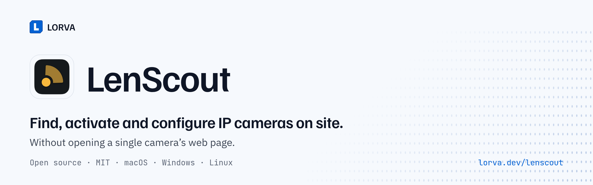

<p align="center"><b>English</b> · <a href="README.fr.md">Français</a></p>

<picture>
  <source media="(prefers-color-scheme: dark)" srcset="docs/assets/banner-en-dark.png">
  
</picture>

# LenScout

[](https://github.com/Ops-Lorva/lenscout/releases/latest)
[](LICENSE)

Find, activate, and configure IP cameras on an install site — without opening a single camera's web page.
One desktop app on macOS, Windows, and Linux. Product page: [lorva.dev/lenscout](https://lorva.dev/lenscout/).

<!-- screenshot: Network tab showing discovered cameras (brand, model, IP, MAC, state). Place image at docs/assets/lenscout-network.png -->

## The problem

Setting up a camera fleet means doing the same chores on every unit: find it on the
network, activate it, set its IP and gateway, fix its time, create its account. The
manufacturer tools are split by brand and often Windows-only — AXIS IP Utility runs on
Windows alone, and each vendor ships its own. So you end up logging into one camera web
page after another, repeating the same steps by hand. It is slow, error-prone, and it
scales badly past a handful of cameras.

## What LenScout does

LenScout is a desktop app for installers and integrators. It discovers the IP cameras on
a network, activates new ones, sets their IP / mask / gateway / DNS, their NTP and time
zone, and their credentials, then shows their live stream so you can aim and focus them
during the install — all from one window, on macOS, Windows, and Linux. It is an
**installation** tool: no continuous monitoring, no recording.

The interface is three tabs — **Network**, **Framing**, **Accounts** — in French,
English, and Spanish.

## Features

### Discovery
- Scans the network and lists cameras with brand, model, IP, MAC, serial, firmware
  version (when readable), and state (new / activated).
- Axis via mDNS (`_axis-video._tcp`), WS-Discovery, and a routed scan; ONVIF as a
  fallback; MAC prefix (OUI) to name a device that answers no protocol.
- Rescan on demand; the list fills in as the scan runs.
- Search by MAC or serial — type what is printed on the box, in any common MAC format
  (`AC:CC:8E:…`, `ACCC8E…`, `ac-cc-8e-…`), and the list narrows to that camera even on a
  network of several hundred devices.
- An **Open web page** button opens `http(s)://IP` in your default browser.

### Network configuration
- Activate a new camera by setting the chosen account's password.
- Switch between DHCP and a static IP, with mask, gateway, and DNS.
- Assign a range in bulk (`10.0.50.11`, `.12`, `.13`…) with a per-camera preview — MAC
  and serial mapped to the IP each will receive — that you confirm before anything is
  applied. A bulk action never touches a camera you did not select.
- A new camera often sits outside the workstation's subnet. For Axis, LenScout
  temporarily adds an IP from the right subnet to your network interface (asking for
  admin rights), configures the camera, then removes that IP again — including after an
  error.

### Accounts
- Save named accounts (for example "LORVA default" or "Client X"), each with a login and
  password, and pick the account at each action that needs authentication — a client may
  have their own credentials.

### Framing
- Connect to a camera with the chosen account and show its live stream, fluid enough to
  aim and focus the camera during the install. Multi-sensor views, zoom, and focus.

### Time
- Set the NTP server and time zone on one or several selected cameras.

### Security of updates and credentials
- Passwords are sealed (XChaCha20-Poly1305) inside the app's accounts file, so the file
  cannot be read or grepped in clear text, and they are never written to a log. The
  sealing key ships with the open-source code: it keeps the file from being read at a
  glance, it is not a vault. Protect the accounts file and its exports like the
  passwords they hold.
- LenScout checks for a newer release at startup. Every installer ships with a `.sig`
  minisign signature, which the app verifies before running anything it downloaded; a
  download that fails verification is not run.

## Camera support

- **Axis — full support**: discovery, activation, IP configuration (DHCP / static),
  credentials, time / NTP, and framing.
- **Hikvision / LTS**: recognised on a routed scan (SADP discovery and ISAPI
  identification), with LTS told apart from Hikvision. Activation and IP change over SADP
  are **not yet enabled** — there is no reliable public source for the SADP password
  encoding, so it is left off until it can be validated on real LTS hardware.
- **Other brands** (found only by ONVIF or MAC prefix): listed, with the **Open web
  page** button, but no in-app configuration.

## Who it's for

- **Installers** setting up camera fleets on site who want one cross-platform tool
  instead of a per-brand, Windows-only patchwork.
- **Integrators** standardising IP, time, and account configuration across many cameras.
- **Field IT** who need to find, reach, and frame a camera on an unfamiliar network
  without hunting through web interfaces.

## Installation

Download the installer for your system from the
[latest release](https://github.com/Ops-Lorva/lenscout/releases/latest):

| System | File |
|---|---|
| macOS (Apple Silicon and Intel) | `lenscout_vX.Y.Z_universal.pkg` (or `.dmg`) |
| Windows 10 / 11 | `lenscout_vX.Y.Z_x64-setup.exe` |
| Debian / Ubuntu | `lenscout_vX.Y.Z_amd64.deb` (`sudo apt install ./lenscout_vX.Y.Z_amd64.deb`) |

The Windows installer is not code-signed, so SmartScreen may warn on first run (More info, Run anyway).

LenScout checks for a newer release at startup and offers to install it. Every
installer ships with a `.sig` minisign signature, which the app verifies before
running anything it downloaded.

## Development

```bash
npm install
npx tauri dev
```

```bash
cargo test -p lenscout-core
cargo clippy --workspace -- -D warnings
npm test
```

## Layout

- `crates/lenscout-core` — all the logic, no Tauri, tested without a camera.
- `src-tauri` — thin Tauri commands.
- `src` — SvelteKit front end (fr, en, es).

## License

MIT — see [LICENSE](LICENSE).

---

<p align="center"><sub>LenScout is made by <a href="https://lorva.dev">LORVA</a>, an independent software studio.</sub></p>
